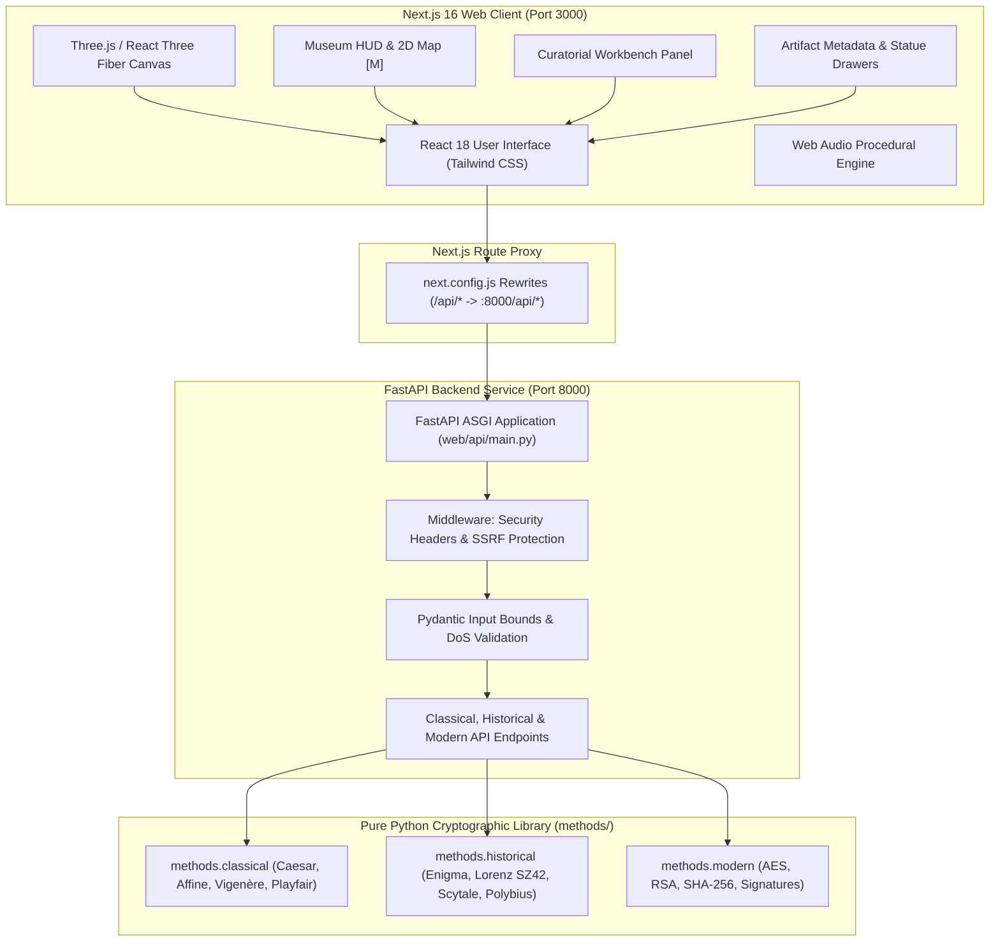

# 🏛️ Cryptography Museum & Cipher Engine

<div align="center">

[](https://nextjs.org/)
[](https://react.dev/)
[](https://threejs.org/)
[](https://fastapi.tiangolo.com/)
[](https://www.python.org/)
[](https://tailwindcss.com/)
[](LICENSE)

[-10B981?style=flat-square&logo=pytest&logoColor=white)](scripts/diagnose.py)
[](methods/)
[](web/)
[](methods/)
[-blue?style=flat-square)](STYLE_GUIDE.md)

**An immersive 3D WebGL museum and educational, zero-external-dependency Python cryptography engine.**

[Explore Museum](#-quickstart--installation) • [Cipher Catalog](#-museum-wings--cipher-catalog) • [Architecture](#-architecture--system-design) • [Python Library](#-python-cryptography-engine) • [Diagnostic Checks](#-testing--diagnostics)

</div>

---

## 📖 Overview

The **Cryptography Museum** is a dual-purpose educational platform combining an interactive, first-person 3D WebGL museum with an audited, high-performance Python cryptography engine.

Visitors can walk through three grand architectural wings spanning over two millennia of secrecy:
1. **Classical Ciphers Wing** (58 BC – 1850s): Ancient Spartan Scytale cylinders, Caesar shift disks, Renaissance Vigenère wheels, Playfair matrix boards, and Polybius watchtower squares.
2. **Historical Systems Wing** (1918 – 1945): Electromechanical WWII rotor engines, including the 3-rotor Enigma Machine (with plugboard and reflector) and the German High Command Lorenz SZ42 12-pinwheel teleprinter stream cipher.
3. **Modern Cryptography Wing** (1970s – Present): Mathematically rigorous asymmetric public-key systems (RSA-4096), symmetric block ciphers (AES-128 Rijndael state matrix), and cryptographic hash cascades (SHA-256 Merkle compression).

Every cipher in the 3D museum connects directly to a live curatorial workbench backed by a FastAPI microservice and native Python implementations, allowing real-time encryption, decryption, input/output swapping, step-by-step playback, and vulnerability exploration.

---

## 🌟 Key Features

- **🏛️ Spatial 3D Radial Museum**: Built with [Three.js](https://threejs.org/) and React Three Fiber. Features an open entrance foyer with three grand exhibition wings radially spaced to prevent occlusion and provide natural acoustic and visual flow.
- **🎮 Dual Traversal Modes**: Seamlessly switch between first-person **WASD / Arrow-key walking** across gallery halls and **OrbitControls 360° inspection** for examining exhibit artifacts up close.
- **🧪 Interactive Curatorial Workbench**: Test ciphers live with custom plaintexts, dynamic keys, instant **Swap I/O**, playback speed sliders, step-by-step animation controls, and real-time ciphertext streaming.
- **📖 Curatorial Drawers & Vulnerability Analysis**: In-depth sliding curatorial dossiers detailing historical context, mathematical formulas, and cryptanalysis vulnerabilities (e.g. letter frequency analysis, Kasiski examination, crib attacks, depth attacks, Shor's quantum algorithm).
- **🗿 Memorial Hall of Fame Statues**: High-fidelity 3D statues in the central foyer honoring the intellectual giants of cryptology: **Al-Kindi** (frequency analysis), **Claude Shannon** (information entropy and perfect secrecy), and **Whitfield Diffie & Martin Hellman [with Ralph Merkle]** (public-key cryptography).
- **🗺️ Interactive 2D Map HUD**: Instant birds-eye museum navigation map accessible via keyboard shortcut (`[M]`) or HUD button.
- **🔊 Procedural 3D Web Audio**: Immersive ambient hall resonance and interactive acoustic feedback synthesized directly via the Web Audio API.
- **🐍 Pure Python Standard Library Invariant**: The entire `methods/` engine is written exclusively using Python standard library primitives (`hashlib`, `hmac`, `os`, `random`, `struct`). No third-party cryptography packages (`pycryptodome`, `cryptography`) are permitted, guaranteeing transparency, auditability, and educational value.
- **⚡ Algorithmic Optimizations**: Precomputed Galois Field $GF(2^8)$ multiplication tables for AES-128 MixColumns (~16x speedup), immutable shift tables for Vigenère, direct codepoint translation maps for Affine/Substitution, and typed-array bitmasks for Playfair.
- **🛡️ Hardened Security**: FastAPI endpoints protected with strict Pydantic input bounds, request length limits (preventing CPU DoS exhaustion), and security headers (`X-Permitted-Cross-Domain-Policies`, strict CORS, SSRF protection).

---

## 🏛️ Museum Wings & Cipher Catalog

| Wing | Exhibit / Cipher | Timeline | 3D Artifact Model | Core Cryptographic Mechanism | Known Vulnerabilities & Attacks | Python Module |
| :--- | :--- | :--- | :--- | :--- | :--- | :--- |
| **Classical** | **Caesar Cipher** | c. 58 BC | Concentric Brass Dial Disk | Monoalphabetic substitution: $C = (P + k) \bmod 26$ | Trivial brute-force (25 keys) & single-letter frequency analysis | [`methods.classical.caesar`](methods/classical/caesar.py) |
| **Classical** | **Scytale Cipher** | c. 400 BC | Helical Parchment Cylinder | Transposition around fixed wooden cylinder of diameter $d$ | Divisor search across message lengths & anagramming | [`methods.historical.scytale`](methods/historical/scytale.py) |
| **Classical** | **Polybius Square** | c. 150 BC | Torch Watchtower & Stone Grid | $5 \times 5$ fractionalization matrix mapping letters to $(row, col)$ | Preserves exact underlying language frequency distributions | [`methods.historical.polybius`](methods/historical/polybius.py) |
| **Classical** | **Vigenère Cipher** | 1553 AD | Jefferson Multi-Rotor Disk Roll | Polyalphabetic substitution via keyword-driven Tabula Recta | Kasiski examination, Friedman test, Index of Coincidence | [`methods.classical.vigenere`](methods/classical/vigenere.py) |
| **Classical** | **Affine Cipher** | c. 1600s | Dual-Gear Calculator Machine | Linear modular arithmetic: $E(x) = (ax + b) \bmod 26$ with $\gcd(a, 26)=1$ | Very small key space (312 keys); vulnerable to known-plaintext pairs | [`methods.classical.affine`](methods/classical/affine.py) |
| **Classical** | **Playfair Cipher** | 1854 AD | Marble Matrix Board & Laser | Digraph substitution on $5 \times 5$ grid (row, col, rectangle rules) | Digram frequency analysis; leaves single-letter frequencies partially obscured | [`methods.classical.playfair`](methods/classical/playfair.py) |
| **Historical** | **Enigma Machine** | 1918–1945 | 3-Rotor Electromechanical Engine | Stepping mechanical rotors, plugboard (Steckerbrett), and reflector | Letters never encrypt to themselves; vulnerable to cribs and Turing Bombe | [`methods.historical.enigma`](methods/historical/enigma/) |
| **Historical** | **Lorenz SZ42** | 1940–1945 | 12-Pinwheel Teleprinter Rig | Stream cipher XORing 5-bit ITA2 Baudot code with 12 pinwheels | Depth attacks from key reuse; broken by Bill Tutte & Colossus | [`methods.historical.lorenz`](methods/historical/lorenz/) |
| **Modern** | **RSA Vault** | 1977 AD | Interlocking Prime Rings & Vault | Asymmetric public key cryptography: $C \equiv M^e \pmod n$, factoring $n = pq$ | Vulnerable to small prime factorization; broken by Shor's quantum algorithm | [`methods.modern.rsa`](methods/modern/rsa.py) |
| **Modern** | **AES-128 Vault** | 2001 AD | $4 \times 4$ ShiftRows Matrix State | Rijndael SPN block cipher: SubBytes, ShiftRows, MixColumns, AddRoundKey | Grover's quantum search reduces effective key strength from 128 to 64 bits | [`methods.modern.aes`](methods/modern/aes.py) |
| **Modern** | **SHA-256 Vault** | 2001 AD | Merkle Tree Compression Cascade | 64-round cryptographic compression function operating on 512-bit blocks | Pre-image resistant, second pre-image resistant, and collision resistant | [`methods.modern.hash_functions`](methods/modern/hash_functions.py) |

---

## 🗿 The Cryptographic Hall of Fame

Located in the museum's central entrance rotunda are 3D interactive memorial statues honoring fundamental pioneers:

```
                      [ HISTORICAL WINGS (Enigma, Lorenz) ]
                                        ▲
                                        │
[ CLASSICAL WINGS ]  ◄─────── [ ENTRANCE ROTUNDA ] ───────►  [ MODERN WINGS ]
(Caesar, Scytale,              [Al-Kindi]   [Shannon]       (RSA, AES, SHA)
 Affine, Vigenere,                   [Diffie-Hellman]
 Playfair, Polybius)                    ▲
                                        │
                                  [ MAIN FOYER ]
```

1. **Al-Kindi (c. 801–873 AD)** — *The Father of Cryptanalysis*  
   Authored *A Manuscript on Deciphering Cryptographic Messages* at Baghdad's House of Wisdom. Introduced statistical frequency analysis, demonstrating that monoalphabetic ciphers could be systematically broken without knowing the key.
   - *Interactive Demo*: Real-time letter frequency distribution analyzer.

2. **Claude Shannon (1916–2001)** — *The Architect of Mathematical Cryptography*  
   Published *Communication Theory of Secrecy Systems* (1949). Defined Information Theory, entropy $H(X)$, the concepts of Confusion and Diffusion, and proved the unconditional secrecy of the One-Time Pad ($H(M|C) = H(M)$).
   - *Interactive Demo*: Information entropy and redundancy calculator.

3. **Whitfield Diffie & Martin Hellman [with Ralph Merkle]** — *Pioneers of Asymmetric Cryptography*  
   Published *New Directions in Cryptography* (1976). Solved the millennia-old key distribution problem using one-way trapdoor mathematical functions, establishing the bedrock for modern internet encryption (TLS/HTTPS).
   - *Interactive Demo*: Interactive Diffie-Hellman modular exponentiation key exchange.

---

## 🏗️ Architecture & System Design



---

## 🚀 Quickstart & Installation

### Prerequisites

| Tool | Minimum Version | Recommended | Purpose |
| :--- | :--- | :--- | :--- |
| **Node.js** | `18.17.0+` | `20.x` or `22.x` | Next.js frontend runtime |
| **npm** | `9.x+` | `10.x+` | Node package manager |
| **Python** | `3.8+` | `3.10+` or `3.11+` | Backend API & cryptographic engines |
| **pip** | `22.x+` | Latest | Python package installer |

### 1. Clone the Repository

```bash
git clone https://github.com/Arjundevjha/Cryptography.git
cd Cryptography
```

### 2. Install Dependencies

```bash
# 1. Install Python backend dependencies
pip install -r web/requirements.txt

# 2. Install Node.js frontend dependencies
cd web && npm install && cd ..
```

### 3. Launch Frontend & Backend Concurrently

From the `web/` directory, run both servers in a single command with hot-reloading:

```bash
cd web
npm run dev:all
```

- **3D Museum Frontend**: [http://localhost:3000](http://localhost:3000)
- **FastAPI Backend**: [http://localhost:8000](http://localhost:8000)
- **Interactive OpenAPI Documentation**: [http://localhost:8000/api/docs](http://localhost:8000/api/docs)

---

### Running Services Separately (Optional)

If you prefer dedicated terminal sessions:

**Terminal 1 — FastAPI Backend**:
```bash
export PYTHONPATH=$(pwd)
python3 -m uvicorn web.api.main:app --port 8000 --reload
```

**Terminal 2 — Next.js Frontend**:
```bash
cd web
npm run dev
```

---

## 🎮 Navigation & Keyboard Controls

| Control | Action |
| :--- | :--- |
| **`[W]`, `[A]`, `[S]`, `[D]`** or **Arrow Keys** | Walk through the museum halls and wings in first-person mode |
| **Left Click + Drag** | Orbit camera 360° around exhibits and pedestals |
| **Right Click + Drag** | Pan camera across the gallery floor |
| **Scroll Wheel** | Zoom in / out to inspect fine artifact engravings and details |
| **`[M]` Key** | Toggle the 2D Birds-Eye Architectural Map overlay |
| **`[Esc]` Key** | Dismiss active Curatorial Metadata Drawer or Statue Modal |
| **Pedestal Click** | Auto-lerp camera directly into exhibit inspection focus |

---

## 🐍 Python Cryptography Engine

All algorithms can be used as a standalone, zero-dependency Python library in any Python project.

```python
# -------------------------------------------------------------
# 1. Caesar Shift Cipher
# -------------------------------------------------------------
from methods.classical.caesar import encrypt as caesar_encrypt, decrypt as caesar_decrypt

ciphertext = caesar_encrypt("DEFEND THE EAST WALL", shift=7)
# -> 'KLMLUK AOL LHZA DHSS'
plaintext = caesar_decrypt(ciphertext, shift=7)
# -> 'DEFEND THE EAST WALL'

# -------------------------------------------------------------
# 2. Ancient Spartan Scytale Transposition
# -------------------------------------------------------------
from methods.historical.scytale import encrypt as scytale_encrypt, decrypt as scytale_decrypt

scytale_cipher = scytale_encrypt("SECRET BATTLEFIELD DISPATCH", diameter=5)
scytale_plain = scytale_decrypt(scytale_cipher, diameter=5)

# -------------------------------------------------------------
# 3. Vigenère Polyalphabetic Cipher
# -------------------------------------------------------------
from methods.classical.vigenere import encrypt as vigenere_encrypt, decrypt as vigenere_decrypt

v_cipher = vigenere_encrypt("ATTACK AT DAWN", key="LEMON")
# -> 'LXFOPV EF RNHR'
v_plain = vigenere_decrypt(v_cipher, key="LEMON")

# -------------------------------------------------------------
# 4. WWII 3-Rotor Enigma Machine Simulation
# -------------------------------------------------------------
from methods.historical.enigma.enigma import Enigma

enigma = Enigma(
    rotors=["I", "II", "III"],
    positions=["A", "B", "C"],
    rings=["A", "A", "A"],
    plugboard_pairs=["AB", "CD", "EF"],
    reflector="B"
)
enigma_cipher = enigma.encipher("OPERATION BARBAROSSA")

# -------------------------------------------------------------
# 5. WWII Lorenz SZ42 12-Pinwheel Teleprinter Stream Cipher
# -------------------------------------------------------------
from methods.historical.lorenz.lorenz import LorenzMachine

lorenz = LorenzMachine(wheel_positions=[0] * 12)
lorenz_cipher = lorenz.encrypt_message("TOP SECRET TELEPRINTER")

# -------------------------------------------------------------
# 6. AES-128 Symmetric Block Cipher (Pure Python Standard Library)
# -------------------------------------------------------------
from methods.modern.symmetric import generate_key, generate_iv, encrypt as aes_encrypt, decrypt as aes_decrypt

key = generate_key()  # 16-byte random AES key
iv = generate_iv()    # 16-byte random initialization vector
cipher_bytes = aes_encrypt("Confidential Museum Manuscript", key, iv)
recovered_text = aes_decrypt(cipher_bytes, key, iv)

# -------------------------------------------------------------
# 7. RSA-4096 Asymmetric Keypair & Cryptosystem
# -------------------------------------------------------------
from methods.modern.rsa import generate_keypair, encrypt as rsa_encrypt, decrypt as rsa_decrypt

public_key, private_key = generate_keypair(bits=2048)
encrypted_blocks = rsa_encrypt("Vault Access Code 9481", public_key)
decrypted_secret = rsa_decrypt(encrypted_blocks, private_key)

# -------------------------------------------------------------
# 8. Cryptographic Hash Functions & Signatures
# -------------------------------------------------------------
from methods.modern.hash_functions import sha256
from methods.modern.digital_signatures import sign_message, verify_signature

digest = sha256("Provenance Certificate Document")
# Deterministic 64-character hexadecimal SHA-256 string
```

> [!CAUTION]
> **No External Cryptography Libraries Allowed**:  
> In accordance with [`STYLE_GUIDE.md`](STYLE_GUIDE.md), importing third-party cryptography libraries (`cryptography`, `pycryptodome`, `pynacl`, etc.) is strictly prohibited. All implementations must use only Python standard library modules to preserve educational clarity and auditability.

---

## ⚡ Performance & Optimization Standards

All cryptography modules undergo rigorous benchmarking to ensure high-throughput execution:

1. **AES Galois Field Lookup Tables**: Pre-computed 256-entry $GF(2^8)$ multiplication lookup tables (`MUL2`, `MUL3`, `MUL9`, `MUL11`, `MUL13`, `MUL14`) replace dynamic bitwise shifting in `MixColumns`, yielding a **~16x speedup** for AES decryption.
2. **BLAKE2 Vectorized Unpacking**: Utilizes `struct.unpack('<16Q')` and inlined scalar variables in BLAKE2b/s round transformations for **~1.3x speedups**.
3. **Vigenère Immutable Shift Arrays**: Precomputed module-level integer shift lookup tables eliminate character-by-character modular arithmetic and string concatenation allocations.
4. **Playfair Typed Array Bitmasks**: Client-side TypeScript adapter uses 128-entry `Uint8Array` bitmasks and `Int32Array` coordinate maps to achieve $O(1)$ coordinate resolution without heap tuple allocations.
5. **Affine Translation Tables**: Replaced character-by-character loops with pre-computed codepoint translation dictionaries executed via `str.translate()`, achieving **~60x speedups**.

---

## 🧪 Testing & Diagnostics

The repository features comprehensive automated test coverage across Python, TypeScript, and end-to-end browser environments.

### Summary of Test Suites

| Suite | Technology | Test Count | Scope |
| :--- | :--- | :--- | :--- |
| **Python Unit Tests** | `pytest` | **801 / 801** | Classical, historical, and modern algorithms, bounds validation, DoS protections, and FastAPI endpoints |
| **Web Unit Tests** | `jest` + React Testing Library | **61 / 61** | React components, Three.js canvas isolation, HUD controls, a11y keyboard dismissal, and audio state |
| **E2E Integration** | `playwright` | Multi-Tier | Full user walkthroughs, timeline navigation, workbench encryption flows, and error recovery |
| **Code Style** | `pylint` | **10.00 / 10** | Strict adherence to PEP 8, docstrings, type annotations, and resource bounds |

### 1. Run Automated Diagnostic Suite

Use the persistent repository diagnostic tool to check all health layers at once:

```bash
python3 scripts/diagnose.py --check
```

Or for verbose error logs:
```bash
python3 scripts/diagnose.py --verbose
```

### 2. Run Python Unit Tests

```bash
# Run all 801 Python tests
pytest

# Run tests with verbose output
pytest -v

# Run tests for a specific category
pytest methods/classical/
pytest methods/historical/
pytest methods/modern/
```

### 3. Run Web Unit & Accessibility Tests

```bash
cd web
npm test
```

### 4. Run End-to-End Playwright Tests

We provide a consolidated, automated test runner in `scripts/run_e2e.sh`:

```bash
# Option A: Via npm script (from web/ directory)
cd web && npm run test:e2e

# Option B: Run script directly from repository root
bash scripts/run_e2e.sh

# Option C: Run against dev server instead of production bundle
bash scripts/run_e2e.sh --dev

# Option D: Automatically install missing Python / Playwright dependencies first
bash scripts/run_e2e.sh --install
```

---

## 📂 Repository Structure

```
Cryptography/
├── methods/                          # Pure Python Standard-Library Cryptography Engines
│   ├── classical/                    # Caesar, Affine, Vigenère, Playfair, Substitution
│   │   ├── affine.py
│   │   ├── caesar.py
│   │   ├── playfair.py
│   │   ├── substitution.py
│   │   ├── vigenere.py
│   │   └── tests/                    # Classical unit test suites
│   ├── historical/                   # Mechanical & Rotor Cipher Machines
│   │   ├── enigma/                   # 3-Rotor Enigma engine, keyboard, plugboard, reflector
│   │   ├── lorenz/                   # 12-Wheel Lorenz SZ42 teleprinter cipher & ITA2 converter
│   │   ├── polybius.py               # 5x5 Polybius Square fractionating cipher
│   │   ├── scytale.py                # Ancient Spartan transposition cylinder
│   │   └── tests/                    # Historical unit test suites
│   ├── modern/                       # Modern Symmetric & Asymmetric Cryptography
│   │   ├── aes.py                    # AES-128 block cipher with GF(2^8) lookup tables
│   │   ├── digital_signatures.py     # HMAC and digital signature schemes
│   │   ├── hash_functions.py         # SHA-256, BLAKE2b/s, MD5 standard library implementations
│   │   ├── keypair.py                # Asymmetric keypair generation & DoS-bounded primes
│   │   ├── rsa.py                    # RSA encryption, decryption & Euler totient arithmetic
│   │   ├── symmetric.py              # CBC / CTR symmetric modes and padding helpers
│   │   └── tests/                    # Modern unit test suites
│   └── tests/                        # Cross-cutting integration tests
├── web/                              # Next.js 16 Web Application & FastAPI Backend
│   ├── api/                          # FastAPI microservice
│   │   ├── main.py                   # ASGI application routes & Pydantic models
│   │   └── test_main.py              # API endpoint unit tests
│   ├── app/                          # Next.js App Router (pages, layout, API routes)
│   │   ├── page.tsx                  # Main 3D museum viewport and overlays
│   │   └── utils/ciphers.ts          # Client-side TypeScript cipher adapters
│   ├── src/components/museum/        # Three.js 3D WebGL scene and museum UI
│   │   ├── ThreeMuseumScene.tsx      # Main 3D canvas, radial wings, artifact meshes
│   │   ├── MuseumCanvas.tsx          # Canvas container & fallback boundary
│   │   ├── museumData.ts             # Exhibits, wings, statues metadata and coordinates
│   │   ├── AudioSystem.tsx           # Procedural Web Audio synthesis
│   │   ├── hud/                      # HUD overlay, 2D floorplan map, status indicator
│   │   └── workbench/                # Curatorial workbench, metadata drawer, statue drawers
│   └── tests/                        # Frontend Jest unit & Playwright E2E suites
│       ├── unit/                     # Component & accessibility unit tests
│       └── e2e/                      # Playwright end-to-end user journey tests
├── scripts/                          # Automated Developer & CI Tooling
│   ├── diagnose.py                   # Health check diagnostic CLI
│   └── run_e2e.sh                    # Consolidated E2E test runner
├── CONTRIBUTING.md                   # Contribution workflow & guidelines
├── STYLE_GUIDE.md                    # Python standards & zero-dependency policy
├── handoff.md                        # Session continuity & architecture handoff notes
├── pytest.ini                        # Pytest configuration
└── LICENSE                           # MIT License
```

---

## 🤝 Contributing

We welcome contributions from cryptographers, historians, software engineers, and 3D web enthusiasts!

Before opening a pull request, please review our contribution documentation:
- 📘 [`CONTRIBUTING.md`](CONTRIBUTING.md): Detailed guide on branch conventions, issue tracking, and PR review lifecycles.
- 📐 [`STYLE_GUIDE.md`](STYLE_GUIDE.md): Code conventions, PEP 8 standards, and the **Zero External Cryptography Libraries** invariant.

### Contribution Workflow

1. **Fork** the repository & create a descriptive feature branch:
   ```bash
   git checkout -b feature/your-algorithm-or-improvement
   ```
2. **Follow Standards**:
   - Implement both `encrypt()` and `decrypt()` functions.
   - Include type annotations, full docstrings, and doctest / usage examples.
   - Strictly avoid external crypto packages—use only the Python standard library.
3. **Verify Everything Passes**:
   ```bash
   # Run full repository health diagnostic
   python3 scripts/diagnose.py --check
   ```
4. **Commit & Open a Pull Request** with a detailed explanation of changes made.

---

## 📜 License

This project is open-source software licensed under the **[MIT License](LICENSE)**.

---

<div align="center">
  <sub>Crafted with precision for cryptology students, security researchers, and history enthusiasts worldwide.</sub>
</div>
